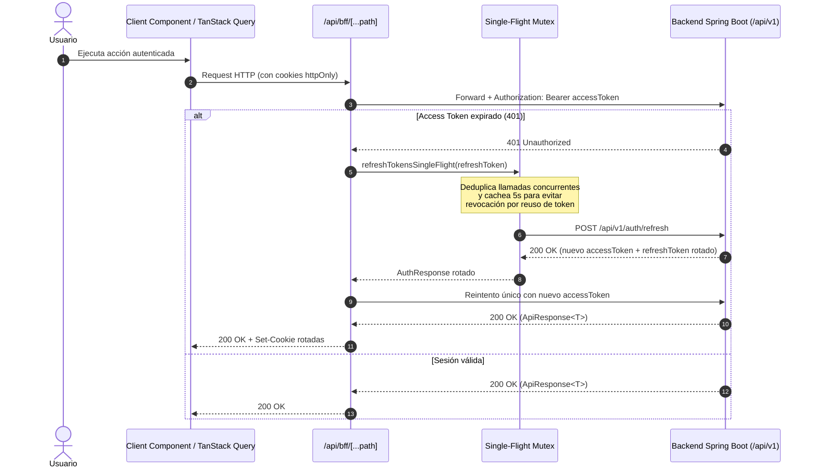

# Plan de Implementación de la API v2 — NexoFood Frontend

> **Versión:** 2.0 (Alineada 100% con el contrato v1 del backend)  
> **Fuentes autoritativas:** [API_DOCUMENTATION.md](./document/API_DOCUMENTATION.md) · [DESIGN.md](./design/DESIGN.md) · [PRODUCT.md](../PRODUCT.md)  
> **Stack Frontend:** Next.js `16.3.3` (App Router) · React `19.2.8` · TypeScript · Tailwind CSS v4 · Zod v4 (`zod@^4.5.4`) · TanStack React Query v5 · Axios (vía BFF) · Zustand (`store-ui.store.ts` solo UI) · `@hello-pangea/dnd` · Leaflet (`leaflet` + `@types/leaflet`) · `pnpm`

---

## 1. Arquitectura General en Next.js 16 App Router

NexoFood implementa una arquitectura híbrida **Server-First + BFF Proxy** sobre **Next.js 16 App Router** para garantizar que los tokens JWT de sesión (`accessToken` de 15 min y `refreshToken` rotativo de 7 días) nunca se expongan al JavaScript del navegador ni a `localStorage`:

1. **`src/proxy.ts` (Convención Next.js 16 — reemplaza `middleware.ts`):**
   - Ejecuta validación optimista de cookies `httpOnly` antes de servir rutas protegidas (`/dashboard`, `/catalog`, `/orders`, `/tracking`, `/employees`, `/customers`, `/onboarding`, `/account`, `/admin`, `/settings`), **sin ningún modo dev o bypass** (`NEXT_PUBLIC_DEV_MODE` eliminado).
   - Si no existen ni cookie de acceso ni de refresco → redirige a `/?callbackUrl=<ruta>`.
   - Si expiró `nexofood_access_token` pero existe `nexofood_refresh_token` → redirige a `/api/auth/refresh?next=<ruta>` (validando open-redirect: `next.startsWith('/') && !next.startsWith('//')`).
   - Si el usuario ya tiene `nexofood_access_token` y navega a rutas de auth (`/`, `/login`, `/register`) → redirige a `/dashboard`.

2. **Server Components y `src/lib/api-server.ts`:**
   - Cargan datos iniciales en SSR leyendo `await cookies()` (asíncrono en Next.js 16) e inyectando `Authorization: Bearer <accessToken>` directamente contra `API_INTERNAL_URL` / `NEXT_PUBLIC_API_URL` (`http://localhost:8080/api/v1`).
   - Desempaquetan el envelope `ApiResponse<T>` y validan opcionalmente la respuesta con esquemas Zod.

3. **Server Actions de Autenticación (`src/lib/auth-actions.ts`):**
   - `loginAction(data)` → `POST /auth/login`
   - `registerAction(data)` → limpia `confirmPassword` y `phone` vacío → `POST /auth/register`
   - `storeLoginAction(slug, data)` → `POST /store/${slug}/auth/login`
   - `storeRegisterAction(slug, data)` → limpia `confirmPassword` y `phone` vacío → `POST /store/${slug}/auth/register`
   - `logoutAction(redirectTo = "/")` → envía `{ refreshToken }` a `POST /auth/logout` (best-effort) y limpia cookies `httpOnly`
   - `clearSessionAction()` → limpia cookies `httpOnly`

4. **BFF Proxy (`/api/bff/[...path]`), Cookies `httpOnly` y Mutex Single-Flight:**
   - Todas las peticiones desde Client Components y hooks de TanStack Query pasan por `axiosClient` (`baseURL: "/api/bff"`, `withCredentials: true`).
   - El Route Handler `src/app/api/bff/[...path]/route.ts` soporta `GET`, `POST`, `PUT`, `PATCH` y `DELETE`:
     - Rechaza explícitamente rutas hacia `webhooks/` (`403`) y secuencias `..` de *path traversal* (`400`).
     - Reenvía hacia `${SERVER_API_BASE_URL}/${path.join("/")}${search}` adjuntando `Authorization: Bearer <accessToken>` desde la cookie `nexofood_access_token`.
     - Preserva headers de respuesta críticos como `Retry-After` y `X-Rate-Limit-Remaining`.
     - Reenvía flujos SSE (`text/event-stream`) sin bufferizar (`backendRes.body`) propagando `request.signal` para cerrar la conexión en el backend al desconectar el cliente.
     - Maneja cuerpos vacíos / `204 No Content` de forma segura.
   - **Cookies `httpOnly` (`src/lib/auth-cookies.ts`):**
     - `nexofood_access_token`: `httpOnly: true`, `sameSite: "lax"`, `secure: NODE_ENV === "production"`, `path: "/"`, `maxAge: expiresIn` (default `900` s).
     - `nexofood_refresh_token`: `httpOnly: true`, `sameSite: "lax"`, `secure: NODE_ENV === "production"`, `path: "/"`, `maxAge: 604800` s (7 días).
   - **Single-Flight Refresh Mutex (`src/lib/server-refresh.ts`):**
     - El backend rota el `refreshToken` en cada `POST /api/v1/auth/refresh` y **revoca TODOS los tokens del usuario si detecta reutilización de un refresh token ya consumido**.
     - Para evitar condiciones de carrera ante peticiones paralelas en SSR o cliente (TanStack Query), `refreshTokensSingleFlight(refreshToken)` mantiene un `Map<string, Promise<AuthResponse>>` en vuelo más una caché de resultado de 5 segundos indexada por el `refreshToken` entrante. Así, múltiples `401` simultáneos comparten un único refresh contra el backend y propagan las nuevas cookies rotadas mediante `Set-Cookie`.
   - **Handlers auxiliares de sesión:**
     - `GET` / `POST` `/api/auth/refresh`: ejecuta `refreshTokensSingleFlight`, actualiza cookies y redirige o responde JSON `{ success: true }`; ante fallo limpia cookies y redirige a `/?session_expired=true&callbackUrl=...`.
     - `POST` `/api/auth/clear`: limpia ambas cookies de sesión.

---

## 2. Variables de Entorno y Configuración Base

- **`.env.example` y `.env.local`:**
  - `NEXT_PUBLIC_API_URL=http://localhost:8080/api/v1`
  - `API_INTERNAL_URL=http://localhost:8080/api/v1`
  - Sin `NEXT_PUBLIC_DEV_MODE` (eliminado).
- **`next.config.ts`:**
  - Configura `images: { unoptimized: true }` para permitir imágenes de logotipos, banners y productos desde dominios arbitrarios configurados por cada restaurante sin romper `next/image`.
- **`tsconfig.json`:**
  - Mantiene `strict: true`, alias `@/* -> ./src/*`, y excluye rutas inexistentes de `include`.
- **Gestor de paquetes:** `pnpm` (`pnpm-workspace.yaml` + `pnpm-lock.yaml`; `package-lock.json` eliminado).

---

## 3. Mapa Completo de Rutas (App Router)

### 3.1. Autenticación, Onboarding y Cuenta Global

| Ruta | Tipo / Acceso | Propósito y Endpoints Consumidos |
| --- | --- | --- |
| `/` | Pública (Auth route) | Inicio de sesión principal SaaS (`loginAction` → `POST /auth/login`), acceso a registro y acceso directo a tienda por slug. |
| `/login` | Pública (Auth route) | Alias/vista de login global unificado con soporte de `callbackUrl` y mensaje de `session_expired=true`. |
| `/register` | Pública (Auth route) | Registro de cuenta global `USER` (`registerAction` → `POST /auth/register`). |
| `/onboarding` | Protegida | Flujo guiado para usuarios sin tienda (`GET /tenants/me` = `404`): selección de plan (`GET /plans`), inicio de `TRIAL` (`POST /subscriptions`) o Checkout MP (`POST /subscriptions/checkout`), y creación de restaurante (`POST /tenants`) con `MapPicker` WGS84. |
| `/account` | Protegida | Perfil global (`GET /auth/me`, `PUT /users/me`), cambio de contraseña (`PATCH /users/me/password`), desactivación de cuenta (`DELETE /users/me`) y libreta de direcciones WGS84 (`/users/me/addresses`). |

### 3.2. Backoffice SaaS del Restaurante (`(saas)`)

| Ruta | Roles Permitidos | Propósito y Endpoints Consumidos |
| --- | --- | --- |
| `/dashboard` | Miembro activo o `SUPERADMIN` | Resumen operativo del restaurante (`GET /tenants/me`), estado de suscripción (`GET /subscriptions/me`), órdenes recientes, entregas activas y accesos rápidos por rol. |
| `/dashboard/subscription` | `OWNER` / usuario titular | Plan actual (`GET /subscriptions/me`), planes públicos (`GET /plans`), historial de cobros (`GET /subscriptions/me/payments`), contratación/upgrade MP (`POST /subscriptions/checkout`) y cancelación (`PATCH /subscriptions/me/cancel`). |
| `/dashboard/subscription/result` | Autenticado | Retorno del checkout recurrente de Mercado Pago; invoca `POST /subscriptions/me/sync` para confirmar estado `ACTIVE` sin esperar webhook. |
| `/dashboard/settings` | `OWNER` (lectura a miembros) | Configuración del restaurante (`PUT /tenants/{id}`), ubicación WGS84 (`MapPicker`), `deliveryRadiusKm`, `defaultDeliveryFee`, y estado operativo (`PATCH /tenants/{id}/status`). *(La ruta heredada `/settings` redirige aquí en Wave 2).* |
| `/dashboard/settings/payments` | `OWNER`, `ADMIN` (conexión/desconexión `OWNER` / `SUPERADMIN`) | Estado de vinculación OAuth Mercado Pago (`GET .../mercadopago/status`), generación de URL OAuth (`GET .../mercadopago/connect`), desconexión (`DELETE .../mercadopago`), lectura de query `?mp=connected` / `?mp=error&reason=...` y tabla de auditoría (`GET .../payments`). |
| `/orders` | Miembro activo o `SUPERADMIN` | Listado paginado y filtros de órdenes (`GET /tenants/{tenantId}/orders`), detalle (`GET .../orders/{id}`), pago (`GET .../orders/{orderId}/payment`), transiciones `OrderStateMachine` (`PATCH .../status`) y asignación de repartidor (`PATCH .../assign`). |
| `/orders/kds` | `OWNER`, `ADMIN`, `COCINERO`, `SUPERADMIN` | Cola FIFO de cocina (`GET /tenants/{tenantId}/orders/kds`) para órdenes en `EN_PREPARACION` y avance a `LISTO_PARA_ENTREGA`. |
| `/orders/deliveries` | `OWNER`, `ADMIN`, `REPARTIDOR`, `SUPERADMIN` | Cola de entregas asignadas (`GET /tenants/{tenantId}/orders/my-deliveries`), transición `EN_CAMINO` / `ENTREGADO` y envío de telemetría GPS (`PUT .../tracking/location`). |
| `/tracking` | `OWNER`, `ADMIN`, `SUPERADMIN` (detalle a miembros) | Mapa Leaflet en tiempo real con entregas activas (`GET /tenants/{tenantId}/tracking/active`) e inspección individual con polilínea histórica (`GET .../orders/{orderId}/tracking?includeHistory=true`). |
| `/catalog` | Lectura miembros; mutación `OWNER`, `ADMIN`, `SUPERADMIN` | Gestión unificada de impuestos (`taxes`), categorías con `sortOrder` (`categories`), productos/stock/disponibilidad (`products`) y reglas de precio/promoción (`products/{id}/prices`), respetando límite `maxProducts`. |
| `/employees` | `OWNER`, `ADMIN`, `SUPERADMIN` | Administración de staff (`GET/POST/PATCH role/DELETE` en `/tenants/{tenantId}/members`) respetando jerarquía de roles. |
| `/customers` | `OWNER`, `ADMIN`, `SUPERADMIN` | CRM de clientes del restaurante (`/admin/tenants/{tenantId}/customers`), ajuste de puntos de lealtad, notas internas privadas y bloqueo/desbloqueo. |

### 3.3. Consola Global de Plataforma (`SUPERADMIN`)

| Ruta | Rol Requerido | Propósito y Endpoints Consumidos |
| --- | --- | --- |
| `/admin/users` | `SUPERADMIN` | Listado paginado de usuarios globales (`GET /admin/users`) y activación/desactivación (`PATCH /admin/users/{userId}/status`). |
| `/admin/plans` | `SUPERADMIN` | CRUD de planes SaaS (`GET`, `GET /{planId}`, `POST`, `PUT`, `PATCH /{planId}/status` en `/admin/plans`). |

### 3.4. Storefront Público y del Comensal (`/store`)

| Ruta | Acceso | Propósito y Endpoints Consumidos |
| --- | --- | --- |
| `/store` | Pública | Portal de acceso directo por `slug` de restaurante (no existe marketplace público ni directorio global en la API v1). |
| `/store/[slug]` | Pública + auth contextual | Cabecera del restaurante (`GET /tenants/slug/{slug}`), menú completo (`GET /store/{slug}/menu`), búsqueda/filtro (`categories`, `products`, `products/{id}`), auth contextual (`/store/{slug}/auth/login|register`), estimación PostGIS de delivery (`GET /store/{slug}/delivery-estimate`), carrito persistente (`/store/{slug}/cart*`) y checkout Mercado Pago (`POST /store/{slug}/orders/checkout`). |
| `/store/[slug]/checkout/result` | Comensal autenticado | Retorno desde Mercado Pago Checkout Pro; realiza *polling* cada 2–3 s sobre `GET /store/{slug}/payments/{paymentId}` hasta confirmar estado final (`APPROVED`, `REJECTED`, etc.) y redirigir/mostrar la orden creada. |
| `/store/[slug]/orders` | Comensal autenticado | Historial paginado de pedidos del cliente en la tienda (`GET /store/{slug}/orders`), detalle (`GET .../orders/{id}`) y cancelación + reembolso solo en `PENDIENTE` (`POST .../orders/{id}/cancel`). |
| `/store/[slug]/orders/[orderId]/tracking` | Comensal dueño de la orden | Mapa Leaflet en vivo (`GET /store/{slug}/orders/{orderId}/tracking`) con *polling* según `pollIntervalSeconds` (`15s`), ETA dinámico e indicador `stale`. Respeta privacidad: oculta coordenadas del repartidor si no está en `EN_CAMINO`. |
| `/store/account` | Comensal autenticado | Perfil personal (`GET /auth/me`, `PUT /users/me`), cambio de contraseña y gestión de direcciones WGS84 (`MapPicker` + `/users/me/addresses`). |

---

## 4. Matriz Completa de Endpoints (8 Módulos · 100 Endpoints de Frontend)

> **Total documentado en backend:** 102 endpoints, de los cuales **100 son consumibles directa o indirectamente por el frontend** y **2 son excluidos explícitamente** por ser webhooks servidor-a-servidor de Mercado Pago.  
> Base URL: `${NEXT_PUBLIC_API_URL}` / `${API_INTERNAL_URL}` (`http://localhost:8080/api/v1`, proxied en cliente vía `/api/bff/...`).

### 4.1. Módulo 1: Identity (14 endpoints)

| # | Método | Ruta (`/api/v1/...`) | Acceso / Rol | Éxito & Envelope |
| --- | --- | --- | --- | --- |
| 1 | `GET` | `/auth/me` | Autenticado | `200` `ApiResponse<UserProfileResponse>` |
| 2 | `POST` | `/auth/register` | Público *(rate-limited)* | `201` `ApiResponse<AuthResponse>` |
| 3 | `POST` | `/auth/login` | Público *(rate-limited)* | `200` `ApiResponse<AuthResponse>` |
| 4 | `POST` | `/auth/refresh` | Público *(rate-limited)* | `200` `ApiResponse<AuthResponse>` |
| 5 | `POST` | `/auth/logout` | Autenticado | `200` `ApiResponse<Void>` |
| 6 | `PUT` | `/users/me` | Autenticado | `200` `ApiResponse<UserResponse>` |
| 7 | `PATCH` | `/users/me/password` | Autenticado | `200` `ApiResponse<Void>` *(incrementa `tokenVersion`)* |
| 8 | `DELETE` | `/users/me` | Autenticado | `200` `ApiResponse<Void>` *(soft-delete + revoca tokens)* |
| 9 | `GET` | `/users/me/addresses` | Autenticado | `200` `ApiResponse<List<CustomerAddressResponse>>` |
| 10 | `POST` | `/users/me/addresses` | Autenticado | `201` `ApiResponse<CustomerAddressResponse>` |
| 11 | `PUT` | `/users/me/addresses/{addressId}` | Propietario | `200` `ApiResponse<CustomerAddressResponse>` |
| 12 | `DELETE` | `/users/me/addresses/{addressId}` | Propietario | `200` `ApiResponse<Void>` |
| 13 | `GET` | `/admin/users` | `SUPERADMIN` | `200` `ApiResponse<PageResponse<UserResponse>>` |
| 14 | `PATCH` | `/admin/users/{userId}/status` | `SUPERADMIN` | `200` `ApiResponse<UserResponse>` |

### 4.2. Módulo 2: Subscription (12 endpoints)

| # | Método | Ruta (`/api/v1/...`) | Acceso / Rol | Éxito & Envelope |
| --- | --- | --- | --- | --- |
| 15 | `GET` | `/plans` | Público | `200` `ApiResponse<List<SubscriptionPlanResponse>>` |
| 16 | `GET` | `/admin/plans` | `SUPERADMIN` | `200` `ApiResponse<List<SubscriptionPlanResponse>>` |
| 17 | `GET` | `/admin/plans/{planId}` | `SUPERADMIN` | `200` `ApiResponse<SubscriptionPlanResponse>` |
| 18 | `POST` | `/admin/plans` | `SUPERADMIN` | `201` `ApiResponse<SubscriptionPlanResponse>` |
| 19 | `PUT` | `/admin/plans/{planId}` | `SUPERADMIN` | `200` `ApiResponse<SubscriptionPlanResponse>` |
| 20 | `PATCH` | `/admin/plans/{planId}/status` | `SUPERADMIN` | `200` `ApiResponse<SubscriptionPlanResponse>` |
| 21 | `GET` | `/subscriptions/me` | Autenticado | `200` `ApiResponse<SubscriptionResponse>` |
| 22 | `GET` | `/subscriptions/me/payments` | Autenticado | `200` `ApiResponse<List<SubscriptionPaymentResponse>>` |
| 23 | `POST` | `/subscriptions` | Autenticado sin `TRIAL`/`ACTIVE` | `201` `ApiResponse<SubscriptionResponse>` |
| 24 | `POST` | `/subscriptions/checkout` | Autenticado sin `ACTIVE` autorizado | `201` `ApiResponse<SubscriptionCheckoutResponse>` |
| 25 | `POST` | `/subscriptions/me/sync` | Autenticado | `200` `ApiResponse<SubscriptionResponse>` |
| 26 | `PATCH` | `/subscriptions/me/cancel` | Titular con `TRIAL` o `ACTIVE` | `200` `ApiResponse<SubscriptionResponse>` |

### 4.3. Módulo 3: Tenant / Store (17 endpoints)

| # | Método | Ruta (`/api/v1/...`) | Acceso / Rol | Éxito & Envelope |
| --- | --- | --- | --- | --- |
| 27 | `GET` | `/tenants/me` | Autenticado | `200` `ApiResponse<TenantResponse>` *(`404` → onboarding)* |
| 28 | `GET` | `/tenants/{id}` | Miembro activo o `SUPERADMIN` | `200` `ApiResponse<TenantResponse>` |
| 29 | `GET` | `/tenants/slug/{slug}` | Público | `200` `ApiResponse<TenantResponse>` |
| 30 | `POST` | `/tenants` | Autenticado con `TRIAL`/`ACTIVE` sin tienda | `201` `ApiResponse<TenantResponse>` |
| 31 | `PUT` | `/tenants/{id}` | `OWNER` o `SUPERADMIN` | `200` `ApiResponse<TenantResponse>` |
| 32 | `PATCH` | `/tenants/{id}/status` | `OWNER` o `SUPERADMIN` | `200` `ApiResponse<Void>` |
| 33 | `GET` | `/tenants/{tenantId}/members` | `OWNER`, `ADMIN`, `SUPERADMIN` | `200` `ApiResponse<List<TenantMemberResponse>>` |
| 34 | `POST` | `/tenants/{tenantId}/members` | `OWNER`, `ADMIN` *(solo `COCINERO`/`REPARTIDOR`)*, `SUPERADMIN` | `201` `ApiResponse<TenantMemberResponse>` |
| 35 | `PATCH` | `/tenants/{tenantId}/members/{memberId}/role` | `OWNER`, `ADMIN` *(sin `ADMIN`/`OWNER`)*, `SUPERADMIN` | `200` `ApiResponse<TenantMemberResponse>` |
| 36 | `DELETE` | `/tenants/{tenantId}/members/{memberId}` | `OWNER`, `ADMIN` *(solo `COCINERO`/`REPARTIDOR`)*, `SUPERADMIN` | `200` `ApiResponse<Void>` |
| 37 | `GET` | `/admin/tenants/{tenantId}/customers` | `OWNER`, `ADMIN`, `SUPERADMIN` | `200` `ApiResponse<Page<TenantCustomerResponse>>` *(excepción `number`)* |
| 38 | `GET` | `/admin/tenants/{tenantId}/customers/{customerId}` | `OWNER`, `ADMIN`, `SUPERADMIN` | `200` `ApiResponse<TenantCustomerResponse>` |
| 39 | `PATCH` | `/admin/tenants/{tenantId}/customers/{customerId}/block` | `OWNER`, `ADMIN`, `SUPERADMIN` | `200` `ApiResponse<TenantCustomerResponse>` |
| 40 | `PATCH` | `/admin/tenants/{tenantId}/customers/{customerId}/notes` | `OWNER`, `ADMIN`, `SUPERADMIN` | `200` `ApiResponse<TenantCustomerResponse>` |
| 41 | `PATCH` | `/admin/tenants/{tenantId}/customers/{customerId}/points` | `OWNER`, `ADMIN`, `SUPERADMIN` | `200` `ApiResponse<TenantCustomerResponse>` |
| 42 | `POST` | `/store/{tenantSlug}/auth/register` | Público *(rate-limited)* | `201` `ApiResponse<StoreAuthResponse>` |
| 43 | `POST` | `/store/{tenantSlug}/auth/login` | Público *(rate-limited)* | `200` `ApiResponse<StoreAuthResponse>` |

### 4.4. Módulo 4: Catalog (29 endpoints)

| # | Método | Ruta (`/api/v1/...`) | Acceso / Rol | Éxito & Envelope |
| --- | --- | --- | --- | --- |
| 44 | `GET` | `/tenants/{tenantId}/taxes` | Miembro activo o `SUPERADMIN` | `200` `ApiResponse<List<TaxResponse>>` |
| 45 | `GET` | `/tenants/{tenantId}/taxes/{taxId}` | Miembro activo o `SUPERADMIN` | `200` `ApiResponse<TaxResponse>` |
| 46 | `POST` | `/tenants/{tenantId}/taxes` | `OWNER`, `ADMIN`, `SUPERADMIN` | `201` `ApiResponse<TaxResponse>` |
| 47 | `PUT` | `/tenants/{tenantId}/taxes/{taxId}` | `OWNER`, `ADMIN`, `SUPERADMIN` | `200` `ApiResponse<TaxResponse>` |
| 48 | `PATCH` | `/tenants/{tenantId}/taxes/{taxId}/status` | `OWNER`, `ADMIN`, `SUPERADMIN` | `200` `ApiResponse<TaxResponse>` |
| 49 | `DELETE` | `/tenants/{tenantId}/taxes/{taxId}` | `OWNER`, `ADMIN`, `SUPERADMIN` | `200` `ApiResponse<Void>` |
| 50 | `GET` | `/tenants/{tenantId}/categories` | Miembro activo o `SUPERADMIN` | `200` `ApiResponse<List<CategoryResponse>>` |
| 51 | `GET` | `/tenants/{tenantId}/categories/{categoryId}` | Miembro activo o `SUPERADMIN` | `200` `ApiResponse<CategoryResponse>` |
| 52 | `POST` | `/tenants/{tenantId}/categories` | `OWNER`, `ADMIN`, `SUPERADMIN` | `201` `ApiResponse<CategoryResponse>` |
| 53 | `PUT` | `/tenants/{tenantId}/categories/{categoryId}` | `OWNER`, `ADMIN`, `SUPERADMIN` | `200` `ApiResponse<CategoryResponse>` |
| 54 | `PATCH` | `/tenants/{tenantId}/categories/{categoryId}/status` | `OWNER`, `ADMIN`, `SUPERADMIN` | `200` `ApiResponse<CategoryResponse>` |
| 55 | `PATCH` | `/tenants/{tenantId}/categories/{categoryId}/sort-order` | `OWNER`, `ADMIN`, `SUPERADMIN` | `200` `ApiResponse<CategoryResponse>` |
| 56 | `DELETE` | `/tenants/{tenantId}/categories/{categoryId}` | `OWNER`, `ADMIN`, `SUPERADMIN` | `200` `ApiResponse<Void>` |
| 57 | `GET` | `/tenants/{tenantId}/products` | Miembro activo o `SUPERADMIN` | `200` `ApiResponse<PageResponse<ProductResponse>>` |
| 58 | `GET` | `/tenants/{tenantId}/products/{productId}` | Miembro activo o `SUPERADMIN` | `200` `ApiResponse<ProductResponse>` |
| 59 | `POST` | `/tenants/{tenantId}/products` | `OWNER`, `ADMIN`, `SUPERADMIN` | `201` `ApiResponse<ProductResponse>` |
| 60 | `PUT` | `/tenants/{tenantId}/products/{productId}` | `OWNER`, `ADMIN`, `SUPERADMIN` | `200` `ApiResponse<ProductResponse>` |
| 61 | `PATCH` | `/tenants/{tenantId}/products/{productId}/availability` | `OWNER`, `ADMIN`, `SUPERADMIN` | `200` `ApiResponse<ProductResponse>` |
| 62 | `PATCH` | `/tenants/{tenantId}/products/{productId}/stock` | `OWNER`, `ADMIN`, `SUPERADMIN` | `200` `ApiResponse<ProductResponse>` |
| 63 | `DELETE` | `/tenants/{tenantId}/products/{productId}` | `OWNER`, `ADMIN`, `SUPERADMIN` | `200` `ApiResponse<Void>` |
| 64 | `GET` | `/tenants/{tenantId}/products/{productId}/prices` | Miembro activo o `SUPERADMIN` | `200` `ApiResponse<List<ProductPriceResponse>>` |
| 65 | `GET` | `/tenants/{tenantId}/products/{productId}/prices/{priceId}` | Miembro activo o `SUPERADMIN` | `200` `ApiResponse<ProductPriceResponse>` |
| 66 | `POST` | `/tenants/{tenantId}/products/{productId}/prices` | `OWNER`, `ADMIN`, `SUPERADMIN` | `201` `ApiResponse<ProductPriceResponse>` |
| 67 | `PUT` | `/tenants/{tenantId}/products/{productId}/prices/{priceId}` | `OWNER`, `ADMIN`, `SUPERADMIN` | `200` `ApiResponse<ProductPriceResponse>` |
| 68 | `DELETE` | `/tenants/{tenantId}/products/{productId}/prices/{priceId}` | `OWNER`, `ADMIN`, `SUPERADMIN` | `200` `ApiResponse<Void>` |
| 69 | `GET` | `/store/{slug}/menu` | Público | `200` `ApiResponse<StorefrontMenuResponse>` |
| 70 | `GET` | `/store/{slug}/categories` | Público | `200` `ApiResponse<List<CategoryResponse>>` |
| 71 | `GET` | `/store/{slug}/products` | Público | `200` `ApiResponse<PageResponse<StorefrontProductResponse>>` |
| 72 | `GET` | `/store/{slug}/products/{id}` | Público | `200` `ApiResponse<StorefrontProductResponse>` |

### 4.5. Módulo 5: Cart (6 endpoints)

| # | Método | Ruta (`/api/v1/...`) | Acceso / Rol | Éxito & Envelope |
| --- | --- | --- | --- | --- |
| 73 | `GET` | `/store/{slug}/cart` | Cliente autenticado no bloqueado | `200` `ApiResponse<CartResponse>` |
| 74 | `POST` | `/store/{slug}/cart/items` | Cliente autenticado no bloqueado | `200` `ApiResponse<CartResponse>` *(retorna `200 OK`)* |
| 75 | `PATCH` | `/store/{slug}/cart/items/{itemId}` | Propietario del carrito | `200` `ApiResponse<CartResponse>` |
| 76 | `PATCH` | `/store/{slug}/cart/notes` | Propietario del carrito | `200` `ApiResponse<CartResponse>` |
| 77 | `DELETE` | `/store/{slug}/cart/items/{itemId}` | Propietario del carrito | `200` `ApiResponse<CartResponse>` |
| 78 | `DELETE` | `/store/{slug}/cart` | Propietario del carrito | `200` `ApiResponse<CartResponse>` |

### 4.6. Módulo 6: Order (10 endpoints)

| # | Método | Ruta (`/api/v1/...`) | Acceso / Rol | Éxito & Envelope |
| --- | --- | --- | --- | --- |
| 79 | `GET` | `/store/{slug}/orders` | Cliente autenticado | `200` `ApiResponse<PageResponse<OrderResponse>>` |
| 80 | `GET` | `/store/{slug}/orders/{id}` | Cliente dueño de la orden | `200` `ApiResponse<OrderResponse>` |
| 81 | `POST` | `/store/{slug}/orders/checkout` | Cliente no bloqueado con carrito no vacío | `201` `ApiResponse<CheckoutPaymentResponse>` |
| 82 | `POST` | `/store/{slug}/orders/{id}/cancel` | Cliente dueño *(solo `PENDIENTE`)* | `200` `ApiResponse<OrderResponse>` |
| 83 | `GET` | `/tenants/{tenantId}/orders` | Miembro activo o `SUPERADMIN` | `200` `ApiResponse<PageResponse<OrderResponse>>` |
| 84 | `GET` | `/tenants/{tenantId}/orders/kds` | `OWNER`, `ADMIN`, `COCINERO`, `SUPERADMIN` | `200` `ApiResponse<List<OrderResponse>>` |
| 85 | `GET` | `/tenants/{tenantId}/orders/my-deliveries` | `OWNER`, `ADMIN`, `REPARTIDOR`, `SUPERADMIN` | `200` `ApiResponse<List<OrderResponse>>` |
| 86 | `GET` | `/tenants/{tenantId}/orders/{id}` | Miembro activo o `SUPERADMIN` | `200` `ApiResponse<OrderResponse>` |
| 87 | `PATCH` | `/tenants/{tenantId}/orders/{id}/status` | Miembro autorizado (`OrderStateMachine`) o `SUPERADMIN` | `200` `ApiResponse<OrderResponse>` |
| 88 | `PATCH` | `/tenants/{tenantId}/orders/{id}/assign` | `OWNER`, `ADMIN`, `SUPERADMIN` | `200` `ApiResponse<OrderResponse>` |

### 4.7. Módulo 7: Payment (7 endpoints de frontend · 2 webhooks excluidos)

| # | Método | Ruta (`/api/v1/...`) | Acceso / Rol | Éxito & Envelope |
| --- | --- | --- | --- | --- |
| 89 | `GET` | `/tenants/{tenantId}/mercadopago/connect` | `OWNER`, `SUPERADMIN` | `200` `ApiResponse<MercadoPagoConnectResponse>` |
| 90 | `GET` | `/tenants/{tenantId}/mercadopago/status` | `OWNER`, `ADMIN`, `SUPERADMIN` | `200` `ApiResponse<MercadoPagoStatusResponse>` |
| 91 | `DELETE` | `/tenants/{tenantId}/mercadopago` | `OWNER`, `SUPERADMIN` | `200` `ApiResponse<Void>` |
| 92 | `GET` | `/mercadopago/oauth/callback` | Público *(validado por `state` HMAC)* | `302` HTML redirect → `/dashboard/settings/payments?mp=...` o `200` `ApiResponse<Map<String, Object>>` |
| 93 | `GET` | `/store/{slug}/payments/{paymentId}` | Cliente propietario del pago | `200` `ApiResponse<PaymentStatusResponse>` |
| 94 | `GET` | `/tenants/{tenantId}/payments` | `OWNER`, `ADMIN`, `SUPERADMIN` | `200` `ApiResponse<PageResponse<PaymentResponse>>` |
| 95 | `GET` | `/tenants/{tenantId}/orders/{orderId}/payment` | Miembro activo o `SUPERADMIN` | `200` `ApiResponse<PaymentResponse>` |

#### ⛔ Exclusión Explícita de Webhooks Servidor-a-Servidor (2 endpoints)
Los siguientes endpoints existen únicamente para la comunicación **Mercado Pago → Backend** y **NO deben ser invocados desde el frontend ni expuestos por el proxy BFF** (`/api/bff/webhooks/*` responde `403 Forbidden`):
- `GET /api/v1/webhooks/mercadopago` (verificación/salud de webhook de Mercado Pago).
- `POST /api/v1/webhooks/mercadopago` (notificaciones asíncronas con firma HMAC-SHA256 `x-signature` y `x-request-id`; no usa `ApiResponse<T>`).

### 4.8. Módulo 8: Tracking (5 endpoints)

| # | Método | Ruta (`/api/v1/...`) | Acceso / Rol | Éxito & Envelope |
| --- | --- | --- | --- | --- |
| 96 | `GET` | `/store/{slug}/delivery-estimate` | Público | `200` `ApiResponse<DeliveryEstimateResponse>` |
| 97 | `GET` | `/store/{slug}/orders/{orderId}/tracking` | Cliente dueño de la orden | `200` `ApiResponse<DeliveryTrackingResponse>` *(coordenadas ocultas fuera de `EN_CAMINO`; `routeHistory: []`)* |
| 98 | `GET` | `/tenants/{tenantId}/tracking/active` | `OWNER`, `ADMIN`, `SUPERADMIN` | `200` `ApiResponse<List<DeliveryTrackingResponse>>` |
| 99 | `GET` | `/tenants/{tenantId}/orders/{orderId}/tracking` | Miembro activo o `SUPERADMIN` | `200` `ApiResponse<DeliveryTrackingResponse>` *(con `includeHistory=true` devuelve `routeHistory`)* |
| 100 | `PUT` | `/tenants/{tenantId}/orders/{orderId}/tracking/location` | `REPARTIDOR` asignado, `OWNER`, `ADMIN`, `SUPERADMIN` | `200` `ApiResponse<DeliveryTrackingResponse>` |

### 4.9. Módulo 9: Notification & Invitations (9 endpoints)

| # | Método | Ruta (`/api/v1/...`) | Acceso / Rol | Éxito & Envelope |
| --- | --- | --- | --- | --- |
| 101 | `GET` | `/notifications` | Autenticado | `200` `ApiResponse<PageResponse<NotificationResponse>>` |
| 102 | `GET` | `/notifications/unread-count` | Autenticado | `200` `ApiResponse<UnreadNotificationCountResponse>` |
| 103 | `GET` | `/notifications/stream` | Autenticado (`Bearer` o `?ticket=`) | `200` `text/event-stream` *(eventos `connected`, `notification`, `unread-count`)* |
| 104 | `POST` | `/notifications/stream-ticket` | Autenticado | `201`/`200` `ApiResponse<NotificationStreamTicketResponse>` |
| 105 | `PATCH` | `/notifications/{id}/read` | Destinatario | `200` `ApiResponse<NotificationResponse>` |
| 106 | `PATCH` | `/notifications/read-all` | Autenticado | `200` `ApiResponse<MarkAllNotificationsReadResponse>` |
| 107 | `POST` | `/notifications/{id}/respond` | Destinatario (`STAFF_INVITATION`) | `200` `ApiResponse<NotificationResponse>` |
| 108 | `GET` | `/invitations` | Autenticado | `200` `ApiResponse<List<TenantMemberResponse>>` |
| 109 | `POST` | `/invitations/{invitationId}/respond` | Usuario invitado | `200` `ApiResponse<TenantMemberResponse>` |

> **Nota sobre elementos preparados internamente en backend (sin endpoint público en v1):** `OrderCreateRequest` / `OrderItemRequest`, `TenantCustomerUpdateRequest` (las mutaciones van separadas en `/block`, `/notes`, `/points`), y búsqueda/listado público global de restaurantes (acceso exclusivo por `slug`).

---

## 5. Contratos, Envelopes, Serialización Estricta y Rate Limiting

### 5.1. Envelopes Estándar y Excepción de Paginación

1. **`ApiResponse<T>`:** `{ success: boolean, message: string, data: T }` (en operaciones sin payload `data` es `null`).
2. **`PageResponse<T>`:** `{ content: T[], page: number, size: number, totalElements: number, totalPages: number, first: boolean, last: boolean }` (`page` es 0-indexed).
3. **⚠️ Excepción Spring Data `Page<TenantCustomerResponse>`:** `GET /api/v1/admin/tenants/{tenantId}/customers` retorna `number` en lugar de `page` dentro de `data`. En `src/schemas/common.schema.ts`, usar `springPageSchema<T>` y `normalizeSpringPage()` para normalizarlo a `PageResponse<T>` antes de pasarlo a la UI (`DataTable` / `Pagination`).
4. **`ErrorResponse`:** `{ message: string, error: string, status: number, timestamp: string, path: string, method: string | null }`.
   - `method` puede ser `null` en errores originados por filtros de seguridad (`401`, `403`, `429`).
   - Errores de validación Jakarta concatenan campos en `message`.
   - Errores `502 Bad Gateway` indican fallo de comunicación con Mercado Pago (`PaymentGatewayException`).

### 5.2. JSON Estricto (`fail-on-unknown-properties: true`) y Reglas de Campos

- El backend rechaza con `400 Bad Request` cualquier propiedad no declarada en el DTO esperado.
- **Obligatorio:**
  - Separar esquemas de formulario UI con campos de confirmación (`registerFormSchema`, `changePasswordFormSchema`, `storeRegisterFormSchema` que contienen `confirmPassword`) de los DTOs estrictos de envío (`userRegisterRequestSchema`, `changePasswordRequestSchema`, `storeRegisterRequestSchema` sin `confirmPassword`).
  - Usar `cleanPayload()` para eliminar claves `undefined` antes de serializar JSON, y omitir cadenas vacías opcionales como `phone: ""` al registrar.
  - Respetar ortografía exacta de enums del backend, incluyendo `PaymentStatus.CANCELED` y `SubscriptionStatus.CANCELED` con **una sola `L`**.
  - **Política de contraseñas:** 8–100 caracteres, mínimo 1 letra (`/[A-Za-z]/`), mínimo 1 dígito (`/\d/`), sin espacios (`!/\s/`).
  - **UUIDs e ISO 8601:** Validar UUIDs como `string` (`z.uuid()` en Zod v4) y formatear fechas ISO 8601 con `Intl.DateTimeFormat("es-PE", ...)`.

### 5.3. Rate Limiting (`429 Too Many Requests`)

- Afecta a `POST /auth/login`, `POST /auth/register`, `POST /auth/refresh`, `POST /store/{tenantSlug}/auth/login`, `POST /store/{tenantSlug}/auth/register` (**10 solicitudes / 60 segundos** por IP y grupo).
- El BFF y los clientes HTTP preservan `Retry-After` y `X-Rate-Limit-Remaining`.
- `QueryClient` (`src/lib/query-client.ts`) **no reintenta** errores `4xx` ni `429`; los formularios muestran el tiempo restante (`Retry-After` segundos) al usuario.

---

## 6. Reglas de Negocio: `OrderStateMachine` y Matriz de Roles

### 6.1. Máquina de Estados de Pedidos (`src/lib/order-state-machine.ts`)

| Estado Actual | Transiciones Permitidas | Restricciones y Efectos Colaterales |
| --- | --- | --- |
| `PENDIENTE` | `EN_PREPARACION`, `CANCELADO` | `EN_PREPARACION` exige pago `APPROVED` (`PaymentGuard` → `409` si no está aprobado). Cancelación por comensal permitida **solo aquí**. |
| `EN_PREPARACION` | `LISTO_PARA_ENTREGA`, `CANCELADO` | Cancelación desde backoffice permitida en `PENDIENTE` o `EN_PREPARACION` (ejecuta reembolso MP + repone stock). |
| `LISTO_PARA_ENTREGA` | `EN_CAMINO` *(solo `DELIVERY`)*, `ENTREGADO` *(solo `TAKEAWAY`/`DINE_IN`)* | Pedidos `DELIVERY` deben pasar obligatoriamente por `EN_CAMINO` (calcula ETA, registra `dispatchedAt` e inicia tracking). |
| `EN_CAMINO` | `ENTREGADO` | Solo `DELIVERY`; al entregar registra `deliveredAt`, cierra tracking y suma puntos de lealtad (`max(1, floor(total))`). |
| `ENTREGADO` | *(ninguna — estado terminal)* | — |
| `CANCELADO` | *(ninguna — estado terminal)* | — |

### 6.2. Matriz de Permisos por Rol (`src/lib/permissions.ts`)

| Capacidad / Módulo | `SUPERADMIN` | `OWNER` | `ADMIN` | `COCINERO` | `REPARTIDOR` | Comensal (`USER`) |
| --- | :---: | :---: | :---: | :---: | :---: | :---: |
| Gestión global de usuarios y planes (`/admin/*`) | ✅ | ❌ | ❌ | ❌ | ❌ | ❌ |
| Suscripción SaaS propia (`/dashboard/subscription*`) | ✅ | ✅ | ❌ | ❌ | ❌ | ❌ |
| Editar config restaurante y status (`/tenants/{id}*`) | ✅ | ✅ | ❌ | ❌ | ❌ | ❌ |
| Conectar / desconectar Mercado Pago OAuth | ✅ | ✅ | Solo ver estado | ❌ | ❌ | ❌ |
| Gestión de `ADMIN` en staff (`/members`) | ✅ | ✅ | ❌ | ❌ | ❌ | ❌ |
| Gestión de `COCINERO` / `REPARTIDOR` (`/members`) | ✅ | ✅ | ✅ | ❌ | ❌ | ❌ |
| Modificar o desvincular al `OWNER` | ❌ | ❌ | ❌ | ❌ | ❌ | ❌ |
| Catálogo (`taxes`, `categories`, `products`, `prices`) | ✅ | ✅ | ✅ | Lectura | Lectura | Menú público |
| Clientes CRM (`/admin/tenants/{id}/customers*`) | ✅ | ✅ | ✅ | ❌ | ❌ | ❌ |
| Órdenes: cancelar y asignar repartidor | ✅ | ✅ | ✅ | ❌ | ❌ | Solo cancelar en `PENDIENTE` |
| Órdenes: pasar a `EN_PREPARACION` / `LISTO_PARA_ENTREGA` | ✅ | ✅ | ✅ | ✅ | ❌ | ❌ |
| Órdenes: pasar a `EN_CAMINO` / `ENTREGADO` | ✅ | ✅ | ✅ | ❌ | ✅ *(si asignado)* | ❌ |
| Mapa `/tracking/active` y `routeHistory` | ✅ | ✅ | ✅ | Solo detalle orden | Solo detalle orden | Solo orden propia en `EN_CAMINO` (sin historial) |
| Pings GPS (`PUT .../tracking/location`) | ✅ | ✅ | ✅ | ❌ | ✅ *(asignado en `EN_CAMINO`)* | ❌ |

---

## 7. Geoespacial PostGIS (WGS84) e Integración de Mapas Leaflet

- **Sistema de coordenadas:** WGS84 (`SRID 4326`), `latitude` (`-90.0` a `90.0`) y `longitude` (`-180.0` a `180.0`) como `number`.
- **Cálculo en backend:** `ST_DistanceSphere` (respaldo Haversine), factor vial `1.35`, velocidad media `25.0 km/h`, radio `deliveryRadiusKm`, throttling de pings de `5s` (`throttled: true`), filtro de saltos anómalos (`> 150 km/h` en `> 250 m`) y señal `stale: true` tras `60s`.
- **Implementación en frontend (`src/components/ui/MapPicker.tsx` y `TrackingMap.tsx`):**
  - Importación dinámica de `leaflet` dentro de `useEffect` (nunca en top-level del módulo para evitar fallos SSR `window is not defined`).
  - Hoja de estilos `leaflet/dist/leaflet.css` cargada en `src/app/globals.css`.
  - Marcadores personalizados con `L.divIcon` e iconos SVG inline (evita iconos PNG rotos por el bundler de Next.js).
  - Capas de OpenStreetMap, botón de geolocalización nativa (`navigator.geolocation`) + campos numéricos accesibles de latitud/longitud en `MapPicker`, y polilínea de `routeHistory` + marcadores de tienda/destino/repartidor en `TrackingMap`.

---

## 8. Estándares de Diseño (`DESIGN.md`) y `modern-web-guidance`

### 8.1. Design System "Nexofood Core" (`docs/design/DESIGN.md`)
- **Tokens `@theme`:** Superficie `#f4fbf4` / `#ffffff`, Primario Fresh Mint (`#006c49` / `#10b981`), Secundario Appetite Tangerine (`#ab3500` / `#fe6a34`) reservado para CTAs críticos y checkout, Texto Deep Navy / On-Surface (`#161d19`), Error (`#ba1a1a`).
- **Tipografía y Espaciado:** **Plus Jakarta Sans**, grilla de 8px (`1280px` max-width en desktop, 12/8/4 columnas), radios amigables (`rounded-lg`, `rounded-xl`, pills), sombras suaves difusas en 3 niveles.
- **Localización y Accesibilidad:** Idioma `es-PE`, moneda `PEN` (`S/ 0.00`), contraste mínimo WCAG AA (≥4.5:1 texto, ≥3:1 elementos UI).

### 8.2. Directrices `modern-web-guidance` Aplicadas en `src/app/globals.css` y `src/components/ui/*`
- **`dialog` (Modales nativos):** Uso de `<dialog>` nativo con `showModal()` / `close()` en `Dialog.tsx`; prohibido añadir `role="dialog"`, `aria-modal`, trampas de foco manuales o bloqueos de scroll en `html`/`body`. Contiene el scroll mediante `dialog:modal { overscroll-behavior: contain; }` y `dialog::backdrop { overflow: hidden; overscroll-behavior: contain; }`. Soporta `closedby` (`"any" | "closerequest" | "none"`) con fallback Safari basado en `pointerdown` + `pointerup` y `getBoundingClientRect()`, y reinicia `dialog.returnValue = ""` al cerrar.
- **`responsive-table` (Tablas accesibles):** `DataTable.tsx` usa `<table>` semántico dentro de `
` con `<caption>`, `<thead>`, `<tbody>`, encabezados sticky (`thead` y `tbody th`) y transformación a tarjetas apiladas mediante `@container (width < 600px)` inyectando `attr(data-label) ": "` en `::before`.
- **`customize-scrollbar-color-and-thickness`:** Uso de propiedades estándar `scrollbar-color` y `scrollbar-width: thin` con contraste ≥3:1, aislando los selectores heredados `::-webkit-scrollbar*` dentro de `@supports not (scrollbar-color: auto)`.
- **Formularios y Movimiento:** `input, select, textarea { font-size: max(1rem, 1em); }` (evita auto-zoom en móviles), `accent-color: var(--color-primary);`, y respeto estricto de `@media (prefers-reduced-motion: reduce)`.

---

## 9. Checklist de Limpieza de Código No Respaldado por la API (Wave 1)

Elementos eliminados en esta re-arquitectura por carecer de respaldo en el contrato v1 del backend:

- [x] Módulo ficticio de Inventario (`src/app/(saas)/inventory/`, `src/modules/inventory/` y entradas `/inventory` en `src/proxy.ts`) — el stock es entero directo por producto en `/products/{productId}/stock`.
- [x] Rutas de Storefront basadas en IDs/mocks (`src/app/store/restaurant/`, `src/app/store/payments/`, `src/app/store/orders/`).
- [x] Marketplace ficticio y componentes de home mock (`StoreHome/`, `HeroBanner/`, `Categories/`, `FilterBar/`, `TopRestaurants/`, `RestaurantGrid/`, `PaymentsView/`, `ReplaceCartDialog/`, `Header/constants.ts`).
- [x] Stores locales sin sincronización backend (`src/stores/cart.store.ts`, `src/stores/orders.store.ts`) — conservando únicamente `src/stores/store-ui.store.ts` para estado volátil de UI.
- [x] Servicios, hooks, utils y esquemas mock (`src/modules/store/constants.ts`, `schemas/store.chema.ts`, `hooks/use-now.ts`, `hooks/use-orders-hydrated.ts`, `services/*.service.ts`, `utils/filter-restaurants.ts`, `utils/store-ref.ts`).
- [x] Placeholders estáticos vacíos (`DashboardKpiSection`, `PriorityOrdersEmpty`, `RecentDispatchesEmpty`, `OrderVolumeChartEmpty`, `EmployeesKpiGrid`, `EmployeesTableEmpty`, `IncidentsEmpty`, `modules/employees/schemas/employee.schema.ts`, `modules/orders/schemas/order.schema.ts`).
- [x] Assets de marcas mock (`public/images/bembos.png`, `edo.png`, `mcdonalds.png`, `neverafit.png`, `pardos.png`, `pizzahut.png`).
- [x] Bypass de desarrollo (`NEXT_PUBLIC_DEV_MODE`), dependencia ajena `react-router`, lockfile duplicado `package-lock.json` y entrada inexistente en `tsconfig.json`.
- [ ] Migración pendiente en Wave 2: `src/app/(saas)/settings/page.tsx` pasará a redirigir a `/dashboard/settings`.

---

## 10. Plan de Ejecución por Olas (Waves)

- **Wave 1 (Base técnica, documentación y contratos):**
  - `docs-and-cleanup`: Dependencias (`leaflet`, `@types/leaflet`, remoción de `react-router` y `package-lock.json`), `.env.*`, `next.config.ts`, `tsconfig.json`, borrado de código no-API, `PRODUCT.md` y este documento (`docs/api_implementation_plan.md` v2).
  - `core-infra`: Esquemas Zod v4 (`src/schemas/*`), capa BFF + single-flight refresh + cookies `httpOnly` + clientes HTTP (`src/lib/*`, `src/app/api/*`), `src/proxy.ts`, estilos `globals.css` y primitivos accesibles/Leaflet en `src/components/ui/*`.
- **Wave 2 (Módulos de negocio y rutas):** Reconstrucción de `(auth)`, `(saas)`, `/admin/*` y `/store/*` consumiendo exclusivamente los 100 endpoints documentados y el BFF proxy.
- **Wave 3 (Verificación integral):** Validación `tsc --noEmit`, `pnpm build`, pruebas de flujos E2E por rol y auditoría de accesibilidad WCAG AA.
